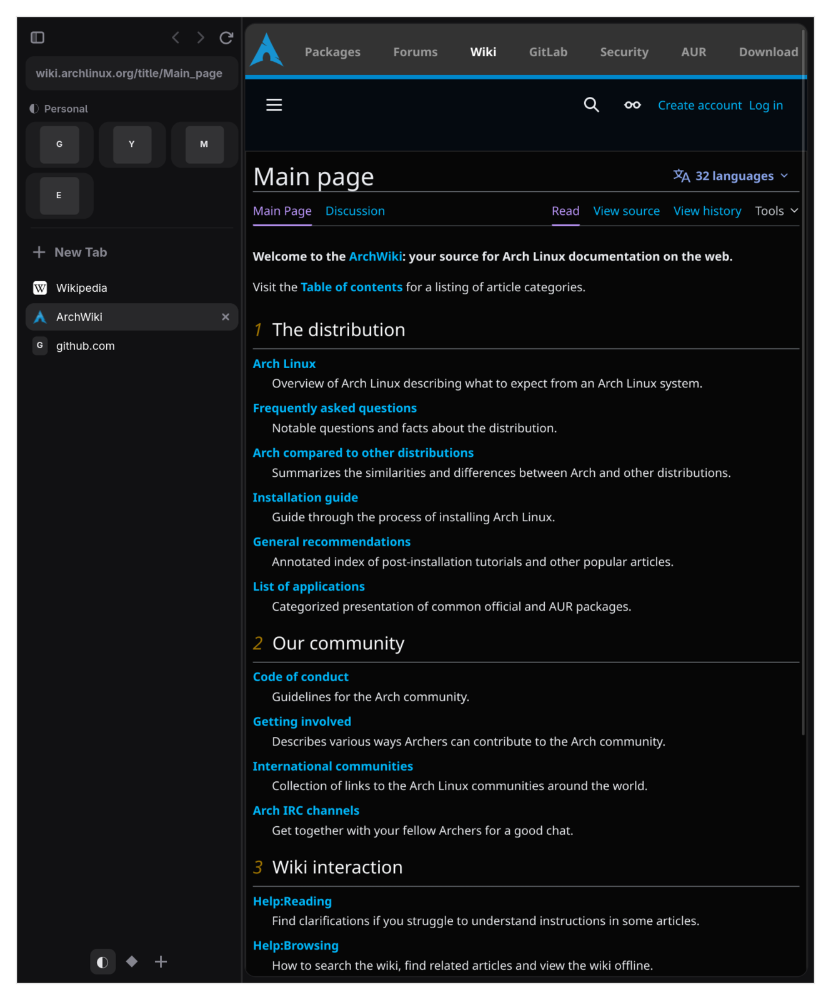
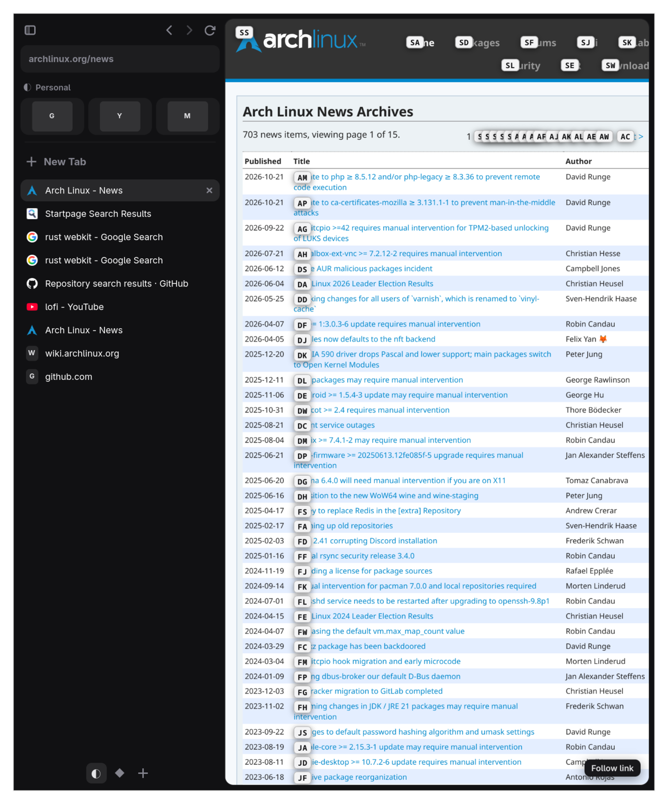
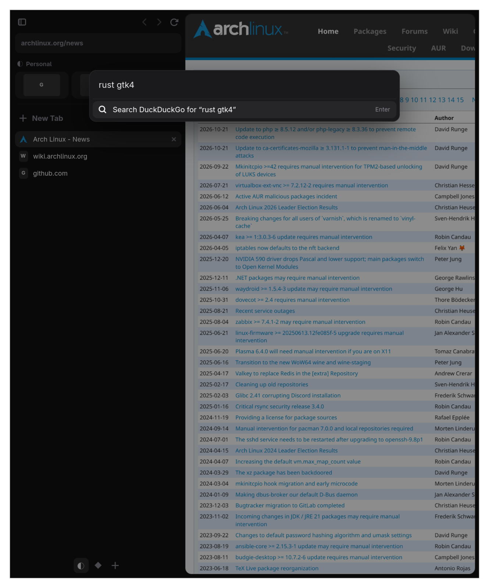
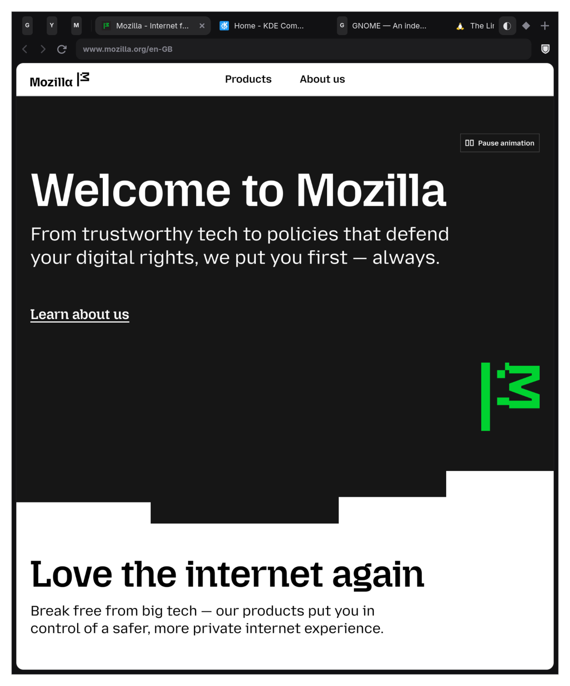
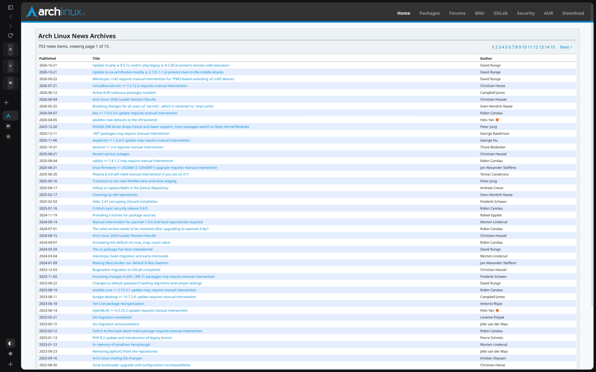
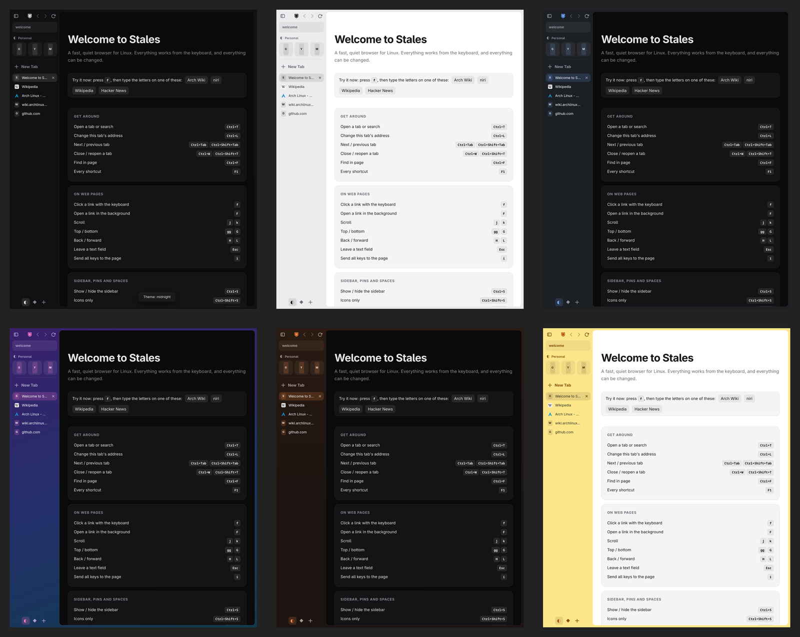

<div align="center">


# Stales

**A fast, quiet web browser for Linux. Tabs in a sidebar, everything from the keyboard, every detail yours to change.**

Written in Rust on GTK 4 and WebKitGTK · made for Arch, Ubuntu and tiling desktops like niri

</div>



> **Early software.** Stales is young (version 0.1). It's good for daily browsing, but expect rough edges, and please [report what breaks](../../issues).

## Why

Arc showed how pleasant a browser can be when tabs live in a sidebar and the browser gets out of the way. It never came to Linux. Stales brings that feel to Linux, and adds what keyboard and tiling-window-manager users want: full keyboard control, plain-text settings, and no telemetry or accounts.

## Features

**Sidebar or tabs on top**
- Arc-style sidebar with **Spaces** (separate sets of tabs), **pinned tabs** and a **command bar** (<kbd>Ctrl</kbd>+<kbd>T</kbd>).
- Drag the sidebar to any width, or shrink it to **icons only** (<kbd>Ctrl</kbd>+<kbd>Shift</kbd>+<kbd>S</kbd>).
- Prefer classic tabs along the top? <kbd>Ctrl</kbd>+<kbd>Alt</kbd>+<kbd>L</kbd> switches.

**Everything from the keyboard**
- Every action has a shortcut, and websites can't take them away.
- **Vimium-style keys on pages:** <kbd>j</kbd>/<kbd>k</kbd> scroll; <kbd>f</kbd> puts letters on every link so you can click one by typing; <kbd>H</kbd>/<kbd>L</kbd> back/forward; <kbd>J</kbd>/<kbd>K</kbd> switch tabs; <kbd>/</kbd> finds.
- <kbd>F1</kbd> shows every shortcut. Change any of them in one text file.

**Private by default**
- A built-in **ad and tracker blocker** uses the same filter lists as uBlock Origin (130 000+ rules). They're applied inside the web engine, so it's faster than an extension. The shield button turns it off per site.
- Third-party cookies are refused, and WebKit's tracking prevention is on.
- No accounts, no telemetry, no sync servers.
- Your cookies, tabs and settings are stored readable by you only.

**Make it yours**
- **Setup on first start:** choose layout, theme, search engine, keyboard style and privacy before you browse.
- **Settings page** (<kbd>Ctrl</kbd>+<kbd>,</kbd> or the gear): look, Spaces (name, icon, colour), search engines, every shortcut (press the new key to change it), filter lists, allowed sites, deleting site data. Changes apply at once and are saved to `config.toml` with your comments kept.
- **Themes:** midnight, paper, graphite, aurora, ember, or your own CSS file.
- **Colour each Space** like in Arc (<kbd>Ctrl</kbd>+<kbd>Alt</kbd>+<kbd>C</kbd>).
- **`user.css`** for any tweak. Save the file and the window updates instantly.
- **Choose your search engine:** DuckDuckGo, Google, Brave, Startpage, Kagi and more, or your own SearXNG. `@w`, `@y`, `@gh` and others search a different site once.

**Remembers everything**
- Spaces, tabs and pins come back after a restart, each tab with its back/forward history. Only the tab you're looking at loads at startup.

<table>
<tr>
<td><br><sub>Press <kbd>f</kbd> and type a label to click a link</sub></td>
<td><br><sub>The command bar: search, open, or jump to a tab</sub></td>
</tr>
<tr>
<td><br><sub>Classic layout with tabs on top</sub></td>
<td><br><sub>Icons-only sidebar</sub></td>
</tr>
</table>



## Install

### Arch Linux

```bash
sudo pacman -S --needed rust gtk4 webkitgtk-6.0 libsecret git
git clone https://github.com/ScaveRace/stales.git && cd stales
./install.sh
```

Or build a package with the included recipe: `cd packaging/arch && makepkg -si`.

### Ubuntu 24.04 or newer, Debian 13

```bash
sudo apt install cargo libgtk-4-dev libwebkitgtk-6.0-dev libsecret-1-dev git
git clone https://github.com/ScaveRace/stales.git && cd stales
./install.sh
```

Ubuntu's `cargo` package may be older than Stales needs (Rust 1.92). If the build complains, install Rust from [rustup.rs](https://rustup.rs) instead.

`./install.sh` installs into `~/.local`, so it needs no sudo. Then start **Stales** from your app launcher or run `stales`. To make it your default browser:

```bash
xdg-settings set default-web-browser dev.stales.Stales.desktop
```

`./install.sh uninstall` removes it again.

### Just try it

```bash
cargo run --release
```

## Settings

Open **Settings** with <kbd>Ctrl</kbd>+<kbd>,</kbd>. Everything there is also in plain text files you can keep in your dotfiles:

| File | What's in it |
|---|---|
| `~/.config/stales/config.toml` | Search engine, theme, layout, every shortcut, filter lists, allowed sites. Written with explanations on first start. |
| `~/.config/stales/user.css` | Your own style tweaks. Changes apply as soon as you save. |
| `~/.config/stales/themes/*.css` | Your own themes. |
| `~/.local/share/stales/` | Your tabs, cookies, cache, and the compiled blocker rules. |

A taste of `config.toml`:

```toml
[appearance]
theme = "aurora"
layout = "arc"          # or "classic"

[search]
engine = "Brave Search"

[keys]
exclude = ["mail.google.com"]   # sites that keep their own single-key shortcuts

[keys.bindings]
close-tab = ["<Ctrl>w", "<Ctrl>q"]

[blocker]
allow = ["example.com"]
```

## Keyboard

The most useful keys; <kbd>F1</kbd> inside Stales shows them all, including any you changed.

| | |
|---|---|
| <kbd>Ctrl</kbd>+<kbd>T</kbd> / <kbd>Ctrl</kbd>+<kbd>L</kbd> | New tab or search / change this tab's address |
| <kbd>Ctrl</kbd>+<kbd>,</kbd> / <kbd>F1</kbd> | Settings / every shortcut |
| <kbd>Ctrl</kbd>+<kbd>Tab</kbd>, <kbd>Ctrl</kbd>+<kbd>1</kbd>…<kbd>9</kbd> | Switch tabs |
| <kbd>Ctrl</kbd>+<kbd>W</kbd> / <kbd>Ctrl</kbd>+<kbd>Shift</kbd>+<kbd>T</kbd> | Close / reopen a tab |
| <kbd>Ctrl</kbd>+<kbd>D</kbd> | Pin or unpin a tab |
| <kbd>Alt</kbd>+<kbd>1</kbd>…<kbd>9</kbd> | Switch Space |
| <kbd>Ctrl</kbd>+<kbd>S</kbd> / <kbd>Ctrl</kbd>+<kbd>Shift</kbd>+<kbd>S</kbd> | Hide the sidebar / icons only |
| <kbd>Ctrl</kbd>+<kbd>Alt</kbd>+<kbd>T</kbd> / <kbd>Ctrl</kbd>+<kbd>Alt</kbd>+<kbd>C</kbd> | Next theme / this Space's colour |
| <kbd>f</kbd> / <kbd>F</kbd> | Click a link / open it in the background |
| <kbd>j</kbd> <kbd>k</kbd> <kbd>d</kbd> <kbd>u</kbd> <kbd>gg</kbd> <kbd>G</kbd> | Scroll |
| <kbd>Esc</kbd> | Leave a text field so single keys work again |
| <kbd>i</kbd> | Send all keys to the page until <kbd>Esc</kbd> |

## Good to know

- **No Chrome or Firefox extensions.** WebKit can't run them. The things most people install extensions for (ad blocking, dark pages, keyboard control) are built in.
- **Netflix, Spotify and other DRM video** usually won't play. WebKitGTK on Linux has no Widevine, which affects every WebKit browser on Linux.
- **No password manager yet.** Stales doesn't save passwords; use KeePassXC, Bitwarden or similar.
- **The engine is WebKitGTK,** the engine of Safari and GNOME Web. It's light on memory and fits Linux well. A few sites tuned only for Chrome may misbehave.

## How it's built

Stales is about 5 000 lines of Rust, written to be readable. Every file starts with a comment explaining what it does.

| File | Purpose |
|---|---|
| `src/state.rs` | Spaces, tabs, pins: plain data, no UI, fully tested |
| `src/window.rs` | The window, and which page shows for which tab |
| `src/sidebar.rs`, `src/topbar.rs` | The two layouts |
| `src/engine/` | The web engine behind an interface (WebKit today; Servo could be added later) |
| `src/engine/keys.js` | Keyboard control inside pages, in an isolated world websites can't see |
| `src/actions.rs` | Every action and its default keys, in one list |
| `src/blocker.rs` | Downloads filter lists and turns them into WebKit content rules |
| `src/theme.rs`, `src/theme/` | Themes, Space colours, user.css, live reload |
| `src/session.rs` | Saving and restoring tabs |
| `src/settings.rs`, `src/settings.html` | The settings page and first-start setup |

```bash
cargo test                     # 42 tests
cargo clippy -- -D warnings    # lint
STALES_CONTROL=1 cargo run     # with a local control socket for scripting/testing (see src/control.rs)
```

Contributions are welcome. Please run `cargo fmt`, `cargo clippy` and `cargo test` before opening a pull request.

## Licence

Stales is free software under the [GNU General Public License v3.0 or later](LICENSE). You may use, study, share and change it; versions you share must stay under the same licence.

It builds on [WebKitGTK](https://webkitgtk.org), [GTK](https://gtk.org), the [gtk-rs](https://gtk-rs.org) bindings and Brave's [adblock-rust](https://github.com/brave/adblock-rust) (MPL-2.0). Filter lists are downloaded from [EasyList](https://easylist.to) and [uBlock Origin](https://github.com/uBlockOrigin/uAssets) at runtime under their own licences.
